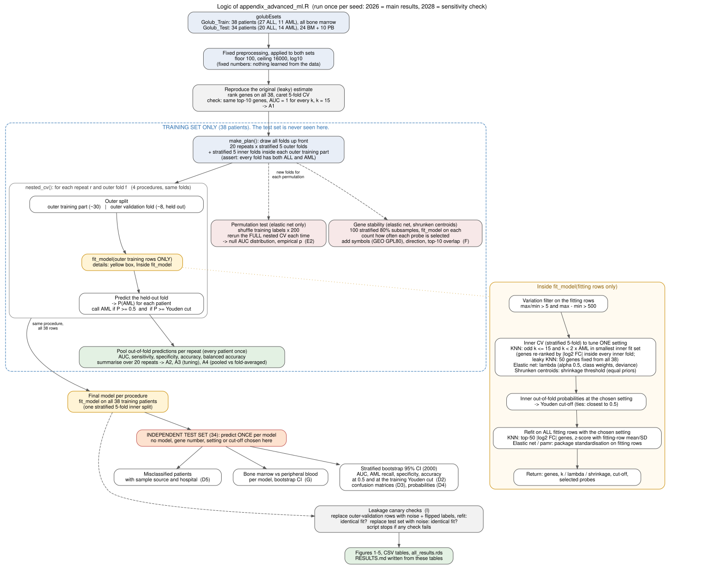

# Flowchart: logic of `appendix_advanced_ml.R`

How to read it, top to bottom:

1. **Data and fixed preprocessing.** The floor of 100, ceiling of 16000 and log10 transform are fixed numbers, so applying them to both sets leaks nothing.
2. **Reproduce the original leaky estimate.** This checks that the appendix starts from the same genes and the same AUC of 1.000 as the main script.
3. **Training set only (blue dashed box).** All folds are drawn first.
   - For every repeat and outer fold, `fit_model()` is given only the outer training rows. It predicts the held-out fold, and the predictions are pooled.
   - The permutation test and the gene-stability analysis reuse the same fitting procedure.
4. **Inside `fit_model()` (yellow box).** The steps are:
   - the variation filter;
   - inner CV to tune one setting per model;
   - a Youden cut-off from the inner out-of-fold probabilities;
   - a refit on all fitting rows.
5. **Final models and the test set.** The same procedure is run on all 38 training patients, and the 34 test patients are predicted once per model.
6. **Leakage canary checks, then tables, figures and RESULTS.md.**

The whole chart runs once per seed: 2026 for the main results and 2028 for the sensitivity check.

To redraw it: `dot -Tpng -Gdpi=170 appendix_flowchart.dot -o appendix_flowchart.png` (requires Graphviz).
